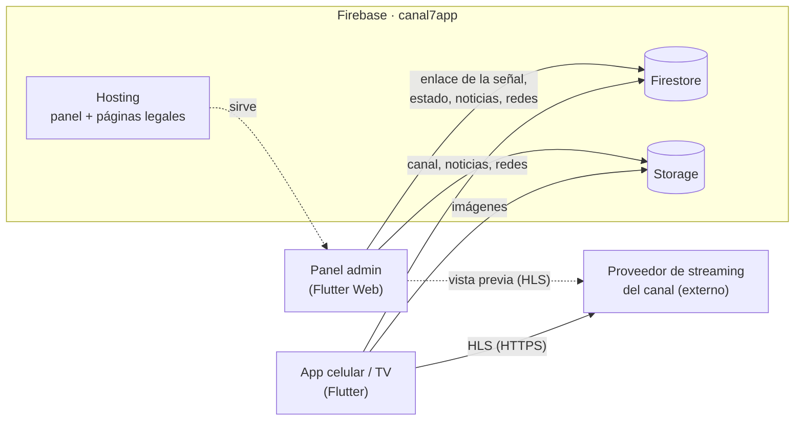

# CCTV CANAL 7

Plataforma de televisión en vivo de **CCTV CANAL 7**: app para celular y para
Android TV, y panel web de administración.

Misma estructura que el proyecto Tulcán Tv, con una diferencia de fondo:
**acá no hay servidor de streaming propio**. El proveedor del canal entrega un
enlace HLS (`.m3u8`) ya listo; el panel solo lo guarda y las apps lo
reproducen.

> Desarrollado por **Orbex Studios** · orbexstudios.ec@gmail.com

---

## 1. Qué hace el sistema

| Para quién | Qué ve |
|---|---|
| **Espectadores** (app de celular) | La señal del canal en vivo apenas abren la app, sin cuenta. Noticias del canal con destacadas y categorías. Menú con redes sociales, privacidad y términos. Imagen en imagen. |
| **Espectadores** (app de TV) | Solo el reproductor a pantalla completa, pensado para control remoto. |
| **El canal** (panel web) | Pegar el enlace de la señal, poner el canal al aire / fuera del aire, vista previa en vivo, noticias y redes sociales. |

## 2. Arquitectura



Firebase guarda los *datos* (enlace y estado del canal, noticias, usuarios,
configuración) y el proveedor externo mueve el *video*.

| Pieza | Dónde corre | URL |
|---|---|---|
| Panel admin | Firebase Hosting | https://canal7app.web.app |
| Política de privacidad | Firebase Hosting | https://canal7app.web.app/privacidad |
| Términos y condiciones | Firebase Hosting | https://canal7app.web.app/terminos |
| Señal HLS | Proveedor del canal | La que se pega en el panel |

## 3. Estructura del repositorio

```
├── admin_panel/          Panel de administración (Flutter Web)
│   └── web/              index.html + privacidad.html y terminos.html
├── viewer_app/           App de espectadores (Flutter: celular + Android TV)
├── firebase/             Reglas, índices, Cloud Functions y build del panel
│   ├── firestore.rules
│   ├── firestore.indexes.json
│   ├── storage.rules
│   ├── functions/src/index.ts
│   ├── public/           ← build del panel que se sube a Hosting (generado)
│   └── scripts/          Scripts de administración con Admin SDK
└── docs/ARCHITECTURE.md  Diseño multi-tenant original (ver nota abajo)
```

> **Nota sobre `docs/ARCHITECTURE.md`:** describe el diseño original de SaaS
> para muchos clientes. El backend sigue siendo multi-tenant por debajo, pero
> acá hay **un solo tenant** (`canal7`) con **un solo canal**. Donde ese
> documento y este README no coincidan, vale este README.

## 4. Componentes

### 4.1 Panel admin — `admin_panel/` (Flutter Web)

Pestañas (en `lib/tenant/tenant_dashboard.dart`):

| Pestaña | Código | Qué hace |
|---|---|---|
| **Canal** | `lib/channel/` | Enlace de la señal, salir al aire / finalizar, vista previa en vivo (hls.js, se reconecta sola), título y descripción. |
| **Noticias** | `lib/news/` | Crear/editar con **vista previa idéntica a la app**, borradores, destacada, categorías, filtros. Las imágenes se comprimen en el navegador (1600 px JPEG) antes de subir. |
| **Reportes** | `lib/reports/` | Visitas, equipos únicos e instalaciones por día (celular y TV), con exportación a **Excel** y **PDF**. Los datos los escribe la app (`viewer_app/lib/stats/usage_tracker.dart`); las descargas oficiales de Play están en Play Console. |
| **Redes sociales** | `lib/settings/` | Enlaces que aparecen en el menú de la app. |

- El panel apunta a un único tenant: slug fijo `canal7` en
  `lib/tenant/tenant_config.dart`.
- Roles (custom claims de Firebase Auth): `tenant_admin` (todo),
  `editor` (gestiona, no borra), `viewer` (solo lectura).
- **Enlace de la señal** (`lib/channel/widgets/channel_source_dialog.dart`):
  tiene que ser `https://`. Android bloquea video sin cifrar y el panel
  tampoco podría mostrarlo.
- **Para que la vista previa del panel funcione**, el servidor del proveedor
  tiene que permitir CORS (el navegador lo exige para HLS). Las apps no lo
  necesitan: si la vista previa no carga pero la app sí reproduce, es eso.

### 4.2 App de espectadores — `viewer_app/` (Flutter)

Un solo *flavor*, `canal7` (`com.orbexstudios.cctvcanal7`, entrada
`lib/main_canal7.dart`), que es **la misma app para celular y Android TV**: al
arrancar, `lib/bootstrap.dart` le pregunta a `MainActivity.kt` si el equipo es
una TV.

| Equipo | Pantalla |
|---|---|
| Celular | `lib/channel/channel_screen.dart` (app completa) |
| Android TV / Google TV | `lib/tv/tv_player_screen.dart` (solo el reproductor, horizontal) |

El manifiesto del flavor (`android/app/src/canal7/AndroidManifest.xml`) declara
Leanback como opcional, el banner de TV y `LEANBACK_LAUNCHER`, así Play Store la
ofrece en las dos tiendas con una sola ficha. Para ver la pantalla de TV en un
celular: `--dart-define=FORCE_TV=true`.

Piezas importantes:

- **La app reproduce solo si el canal está "al aire" y hay enlace.** Como no
  hay servidor propio que avise si la señal está arriba, el interruptor es el
  botón del panel. Con el canal fuera del aire, la app muestra la pantalla de
  "Fuera del aire".
- **`lib/channel/live_playback_controller.dart`**: el reproductor reconecta
  solo ante errores a mitad de reproducción o si el video se congela ~12 s
  (con backoff).
- **`lib/news/widgets/news_visuals.dart`** existe **idéntico** en
  `admin_panel/lib/news/widgets/`, para que la vista previa del panel sea
  exactamente la app. Si cambias uno, copia el otro.
- **Ícono y splash**: generados desde `branding_src/` (fuera de `assets/` a
  propósito, para no inflar la app):
  ```bash
  dart run flutter_launcher_icons
  dart run flutter_native_splash:create
  ```
  ⚠️ Las imágenes actuales son **provisionales** (un "7" en un círculo): hay
  que reemplazarlas por el logo real del canal. Ver §8.
- TV: usa `VideoViewType.platformView` (en algunas cajas genéricas el modo
  por defecto se ve verde) y un `WakeLock` nativo en `MainActivity.kt` contra
  el protector de pantalla.

### 4.3 Firebase — `firebase/`

Proyecto `canal7app`.

| Cloud Function | Tipo | Para qué |
|---|---|---|
| `createTenant`, `setUserRole` | Callable | Alta de tenants y asignación de roles (custom claims). El panel no las usa todavía; el alta inicial se hace con los scripts de `firebase/scripts/`. |

Reglas destacadas (`firestore.rules`):
- `tenantsPublic/{slug}`: lectura pública, **sin escritura desde el cliente**.
- `tenants/{id}/streams/main`: lectura pública (es lo que lee la app),
  escritura del staff.
- `tenants/{id}/news`: solo las **publicadas** son públicas. Por eso la consulta
  de la app **tiene** que filtrar `published == true` (si no, Firestore la
  rechaza entera). Usa el índice compuesto `published + createdAt`.
- `tenants/{id}/settings/{doc}`: lectura pública, escritura del staff (redes
  sociales).
- `tenants/{id}/stats/{yyyy-MM-dd}`: la app (sin cuenta) solo puede **sumar 1**
  a los contadores conocidos; solo el panel los lee. Nadie borra.

## 5. Modelo de datos (Firestore)

```
tenantsPublic/canal7                    Marca pública: nombre, logo, colores, tenantId
tenants/{tenantId}
  ├── streams/main                      EL canal: status live|offline, playbackUrl
  │                                     (servidor principal), sources [{id, name,
  │                                     url, days}] (servidores por día), title,
  │                                     description, startedAt, endedAt
  ├── news/{id}                         title, summary, body, category, imageUrl,
  │                                     imagePath, featured, published,
  │                                     createdAt, updatedAt
  ├── schedule/{id}                     Parrilla: title, host, description,
  │                                     days [1=lun..7=dom], start/end "HH:mm"
  │                                     (end "00:00" = medianoche)
  ├── settings/social                   facebook, instagram, tiktok, youtube, x,
  │                                     whatsapp, website
  └── stats/{yyyy-MM-dd}                Contadores del día: visits, devices,
                                        installs (+ sus versiones …Phone / …Tv)
users/{uid}                             Perfil + rol (espejo de los custom claims)
```

> ⚠️ `canal7` es solo el *slug*. El ID real del tenant lo genera
> `createTenant.js` y queda en `tenantsPublic/canal7.tenantId`.

Storage: `tenants/{tenantId}/news/*.jpg` (imágenes de noticias, públicas) y
`tenants/{tenantId}/branding/` (logo).

## 6. Puesta en marcha (una sola vez)

1. **En la consola de Firebase** (proyecto `canal7app`): activar
   **Authentication** (proveedor correo/contraseña), **Firestore** y
   **Storage**. Las Cloud Functions necesitan el plan Blaze; el panel y las
   apps funcionan sin desplegarlas.
2. **Reglas e índices:**
   ```bash
   cd firebase
   firebase deploy --only firestore:rules,firestore:indexes,storage --project canal7app
   ```
3. **Llave del Admin SDK:** Project settings → Service accounts → *Generate
   new private key* → guardar como `firebase/scripts/serviceAccountKey.json`
   (está en `.gitignore`; nunca subirla).
4. **Crear el canal y el primer usuario:**
   ```bash
   cd firebase/scripts
   npm install
   node createTenant.js
   # Crear antes el usuario en Authentication > Add user
   node setUserRole.js correo@ejemplo.com tenant_admin
   ```
5. **Publicar el panel** (ver §7), entrar con ese usuario, pegar el **enlace
   de la señal** en la pestaña Canal y pulsar **Salir al aire**.

## 7. Publicar cambios

### Panel admin
```bash
powershell -ExecutionPolicy Bypass -File admin_panel/deploy-hosting.ps1
```
Compila, copia el build a `firebase/public/` y despliega a Hosting. Después,
recargar el panel con Ctrl+F5. Las páginas legales salen de
`admin_panel/web/*.html` y se publican con el mismo comando.

### Reglas, índices y funciones
```bash
cd firebase
firebase deploy --only firestore:rules,firestore:indexes,storage --project canal7app
firebase deploy --only functions --project canal7app
```

### App de celular (Google Play)
1. Subir `version:` en `viewer_app/pubspec.yaml` (el número después del `+`
   tiene que ser mayor que el último subido).
2. Generar el AAB firmado:
   ```bash
   cd viewer_app
   flutter build appbundle --release --flavor canal7 -t lib/main_canal7.dart
   ```
   Sale en `build/app/outputs/bundle/canal7Release/app-canal7-release.aab`.
3. Requiere `android/key.properties` + `android/upload-keystore.jks` (ver §8).
   Sin ellos el build cae a la firma de debug y Play lo rechaza.

APK para instalar a mano (sirve en celular y en TV): `flutter build apk --release --flavor canal7 -t lib/main_canal7.dart`.

> `viewer_app` pide Dart `^3.13.5` (Flutter 3.47 o más nuevo).

## 8. Pendientes antes de publicar

| Qué | Dónde |
|---|---|
| **Logo real del canal** | Reemplazar las 5 imágenes de `viewer_app/branding_src/` y `viewer_app/assets/branding/canal7_logo.png` (mismos tamaños), el banner de TV `android/app/src/canal7/res/drawable/tv_banner.png` (320×180) y regenerar ícono/splash (§4.2). También los íconos de `admin_panel/web/`. |
| **Colores de marca** | `tenantsPublic/canal7` (`primaryColor`, `secondaryColor`); los valores iniciales de `createTenant.js` son provisionales. |
| **Clave de subida a Play** | Crear `viewer_app/android/upload-keystore.jks` + `key.properties` **propios de esta app** y respaldarlos fuera de la PC. Si se pierden, hay que pedirle a Google que reemplace la clave (tarda días). |
| **Textos legales** | `admin_panel/web/privacidad.html` y `terminos.html` son una adaptación de las de Tulcán Tv: revisarlas con el canal (responsable, proveedor de la señal, contacto). |
| **`applicationId`** | `com.orbexstudios.cctvcanal7` (+ `.tv`). No se puede cambiar después de publicar en Play: si el canal quiere otro, cambiarlo antes (Gradle, carpeta de `MainActivity.kt` y apps registradas en Firebase). |

## 9. Secretos y credenciales

**Ninguno está en git** (ver los `.gitignore`). Tienen que estar respaldados
aparte.

| Secreto | Dónde vive | Para qué |
|---|---|---|
| `viewer_app/android/upload-keystore.jks` + `key.properties` | Solo en la PC de desarrollo | Firmar el AAB para Google Play |
| `firebase/scripts/serviceAccountKey.json` | PC de desarrollo | Scripts con Admin SDK (se puede generar otra en la consola) |

## 10. Cosas que ya nos mordieron (heredadas de Tulcán Tv)

| Problema | Causa | Solución aplicada |
|---|---|---|
| Apps colgadas para siempre | Solo se manejaban errores al iniciar | `LivePlaybackController` con vigilancia y reconexión |
| Pantalla verde en cajas Android TV | `TextureView` en ciertos chips | `VideoViewType.platformView` |
| `StreamBuilder` cargando infinito | `hasData` es `data != null` y "offline" se modelaba como `null` | Usar `connectionState == waiting` |
| Noticias subidas no aparecían | Se usó el slug como ID del tenant | Usar el `tenantId` real (`tenantsPublic/canal7.tenantId`) |
| Tildes rotas en archivos `.dart` | PowerShell 5.1 (`Get-Content`/`Set-Content`) lee como ANSI y agrega BOM | Editar con el editor, no con esos comandos |
